# Fretly API

[](https://github.com/EnzoCohen/fretly-etu01/actions/workflows/ci-cd.yml)

API de suivi d'expéditions de la société **Fretly** (transport de colis entre professionnels).

API en production : http://51.44.164.69:8001/docs

## Stack

Python 3.12 avec FastAPI et SQLAlchemy 2. PostgreSQL en production, SQLite en développement. Les tests passent par pytest et le lint par ruff.

## Lancer en local sans Docker

```bash
python -m venv .venv
source .venv/bin/activate          # Windows : .venv\Scripts\activate
pip install -r requirements-dev.txt
API_KEY=dev uvicorn app.main:app --reload
```

Documentation interactive : http://localhost:8000/docs

## Lancer en local avec Docker

```bash
cp .env.dist .env       # puis remplacer les valeurs
docker compose up --build
```

## Tests et lint

```bash
pytest
ruff check .
```

## Routes

| Méthode | Route                    | Clé d'API | Rôle                                       |
| ------- | ------------------------ | --------- | ------------------------------------------ |
| GET     | `/health`                | non       | État de l'API et de la base                |
| GET     | `/version`               | non       | Version et commit déployés                 |
| GET     | `/shipments`             | non       | Liste des expéditions                      |
| GET     | `/shipments/{id}`        | non       | Détail d'une expédition (avec prix)        |
| POST    | `/shipments`             | oui       | Créer une expédition                       |
| PATCH   | `/shipments/{id}/status` | oui       | Changer le statut                          |
| POST    | `/shipments/import`      | oui       | Import CSV (voir `data/colis-exemple.csv`) |

La clé d'API se passe dans l'en-tête `X-API-Key`.

## Variables d'environnement

| Variable       | Défaut                    | Rôle                                 |
| -------------- | ------------------------- | ------------------------------------ |
| `DATABASE_URL` | `sqlite:///./fretly.db`   | Chaîne de connexion SQLAlchemy       |
| `API_KEY`      | (vide : écriture refusée) | Clé exigée sur les routes d'écriture |
| `APP_ENV`      | `development`             | Nom de l'environnement               |
| `APP_VERSION`  | `0.0.0-dev`               | Version affichée par `/version`      |
| `GIT_COMMIT`   | `unknown`                 | Commit affiché par `/version`        |

# Rapport

## Audit initial

L'audit de l'archive, fait avant le premier commit, est ici : [docs/audit-initial.md](docs/audit-initial.md). Il contient les constats Trivy, ce que Trivy ne voit pas, les corrections et les sorties avant/après.

## Stratégie de branches

J'ai choisi **GitHub Flow**. `main` est la seule branche permanente et doit toujours être stable, puisque chaque push dessus part en production. Chaque modif se fait sur une branche courte (`feature/docker`, `feature/ci`, `feature/deploy`…) qui revient dans `main` par une Pull Request une fois la CI verte.

Je n'ai pas pris GitFlow parce que je suis seul sur le projet et qu'il n'y a qu'un serveur. Une branche `develop` et des branches de release ajouteraient des fusions sans rien apporter. Avec GitHub Flow c'est simple : une branche, une PR, la CI vérifie, on fusionne et le déploiement part tout seul.

### Protection de `main`

`main` est protégée par le ruleset `protection-main`, sans exception possible. Il faut passer par une Pull Request, et les checks `lint`, `test (3.12)`, `test (3.13)`, `scan-repo` et `build` doivent être verts sur une branche à jour. Le push direct, le force-push et la suppression de la branche sont interdits.

Les commits suivent Conventional Commits, et le commit de fusion reprend le titre de la PR pour garder le même format.

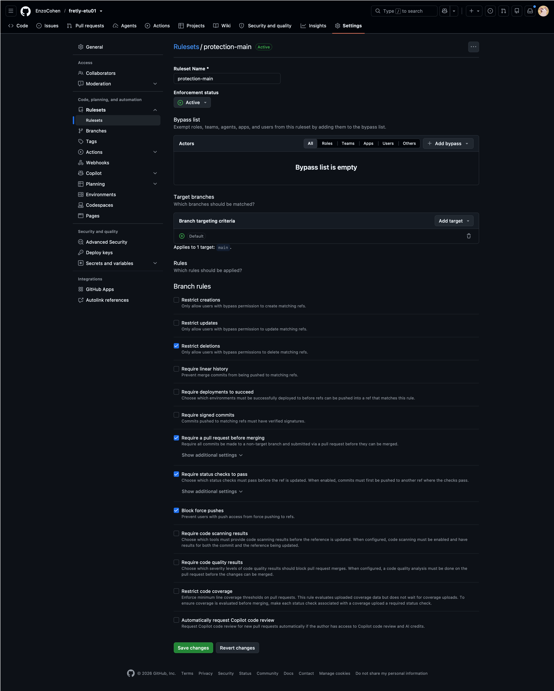
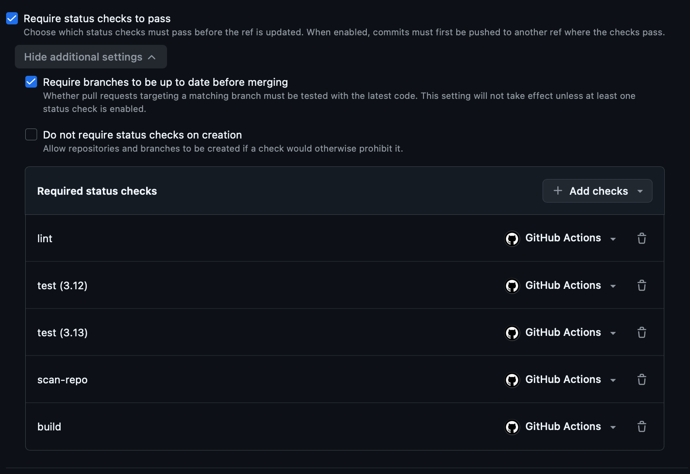

## Choix du Dockerfile

J'ai pris `python:3.12.13-alpine3.23`, avec une version précise et jamais `latest`. J'avais d'abord essayé `python:3.12-slim`, mais l'image faisait environ 260 Mo, au-dessus de la limite de 200 Mo. Avec Alpine elle fait **environ 110 Mo**.

Le build se fait en deux étapes : la première installe les dépendances dans un venv, la deuxième ne garde que ce venv et le dossier `app/`. Il n'y a donc ni compilateur, ni cache pip, ni tests dans l'image finale.

Côté sécurité, l'API tourne avec un utilisateur `fretly` et pas en root. Un `apk upgrade` récupère les correctifs Alpine à chaque build (au premier scan, Trivy trouvait des failles HIGH dans openssl, libuuid et sqlite). J'ai aussi retiré pip de l'image finale, il ne sert plus une fois l'appli installée. Le `.dockerignore` laisse `.git`, `.env`, les tests et les caches en dehors du build. Au final, `trivy config` ne remonte rien et `trivy image` ne trouve aucune faille HIGH/CRITICAL corrigeable.

Le commit est passé au build avec `GIT_COMMIT` et ressort sur `/version`, et un `HEALTHCHECK` appelle `/health`.

## Pipeline CI/CD

Tout est dans [.github/workflows/ci-cd.yml](.github/workflows/ci-cd.yml).

| Job | Push sur `main` | Pull Request | Lancement manuel |
|---|---|---|---|
| `lint`, `test`, `scan-repo` | oui | oui | oui |
| `build` (build, scan, SBOM) | oui | oui | oui |
| `build` (push ghcr.io) | oui | non | oui |
| `deploy` | oui | non | non |

Le workflow n'a aucun droit par défaut (`permissions: {}`) et chaque job ne demande que ce qu'il lui faut. L'action Trivy et les actions Docker sont épinglées par SHA de commit. Sur une PR, un nouveau commit annule le run en cours, et le job `deploy` a son propre groupe de concurrence pour ne jamais lancer deux déploiements en même temps.

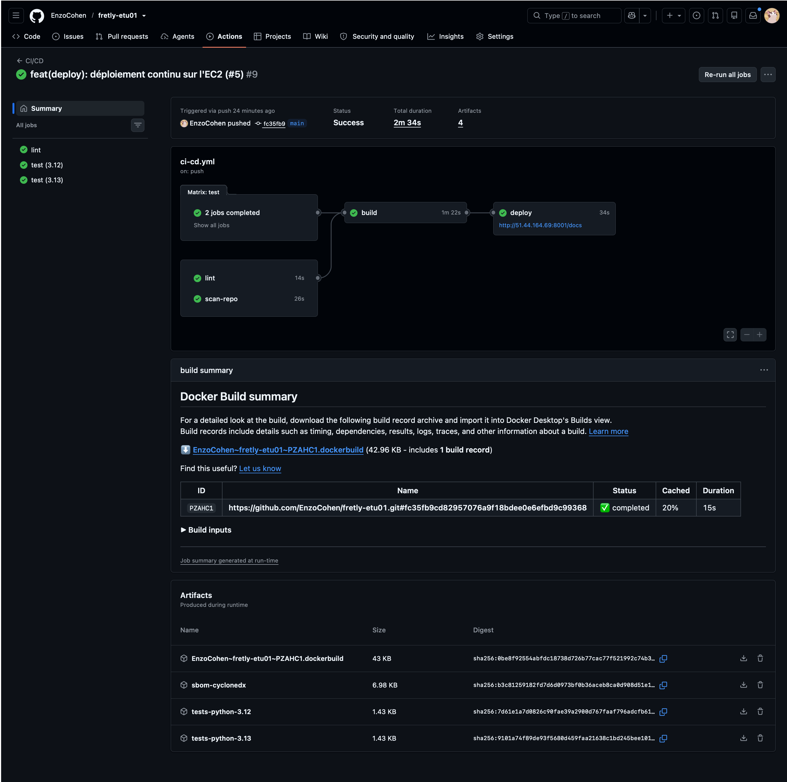

## Secrets et variables

| Nom | Type | Emplacement | Job qui l'utilise |
|---|---|---|---|
| `GITHUB_TOKEN` | Secret (automatique) | Fourni par GitHub Actions | `build`, `deploy` |
| `SSH_PRIVATE_KEY` | Secret | Environnement `production` | `deploy` |
| `SSH_KNOWN_HOSTS` | Secret | Environnement `production` | `deploy` |
| `API_KEY` | Secret | Environnement `production` | `deploy` |
| `POSTGRES_PASSWORD` | Secret | Environnement `production` | `deploy` |
| `EC2_HOST` | Variable | Environnement `production` | `deploy` |
| `EC2_USER` | Variable | Environnement `production` | `deploy` |
| `APP_PORT` | Variable | Environnement `production` | `deploy` |

## Réponses aux questions

### Pourquoi bloquer seulement sur les vulnérabilités corrigeables ?

Une faille sans correctif, on ne peut rien y faire : il n'existe pas de version à installer. Si elle bloquait le pipeline, plus aucun déploiement ne passerait pendant des semaines, même pas un correctif urgent. On bloque donc sur ce qu'on peut vraiment corriger.

Le risque, c'est de partir en production avec une faille connue mais pas encore corrigée. Pour la suivre, chaque build garde un SBOM CycloneDX qui permet de rescanner une version déjà déployée. Et comme le scan tourne à chaque push, dès qu'un correctif sort la faille devient bloquante et force la mise à jour.

### Pourquoi scanner l'image avant de la publier ?

Une fois sur ghcr.io, n'importe qui peut tirer l'image, et `latest` pointerait sur une version vulnérable. Scanner après, c'est découvrir le problème quand l'image est déjà disponible. En scannant avant, une image vulnérable n'arrive jamais dans le registre. C'est aussi pour ça qu'on ne construit l'image qu'une fois : celle qui est scannée est exactement celle qui est publiée.

### Pourquoi déployer le tag `sha-…` plutôt que `latest` ?

`latest` change à chaque build, on ne sait donc jamais vraiment quelle version tourne. Avec `sha-…` on sait exactement quel commit est en production (c'est ce que vérifie le smoke test avec `/version`), ce qui règle le problème de traçabilité de l'audit. Le déploiement est reproductible, et pour revenir en arrière il suffit de redéployer un ancien tag.

### Que donne le groupe `docker` sur ce serveur partagé ?

En pratique, les droits root. Le démon Docker tourne en root, donc n'importe quel membre du groupe peut monter tout le disque dans un conteneur et lire ou modifier n'importe quel fichier, y compris le `.env` des autres étudiants. Il peut aussi voir les variables d'environnement des autres conteneurs avec `docker inspect`, ou les arrêter. Les règles du serveur tiennent donc sur la confiance, pas sur une vraie barrière technique.

En production, je mettrais une machine ou un service managé (ECS/Fargate) par application, sans comptes partagés. Si on garde Docker sur une VM, il faudrait du Docker rootless ou Podman. Les secrets iraient dans AWS Secrets Manager plutôt que dans un `.env`, la base sur RDS dans un réseau privé, avec du HTTPS devant l'API.

## Preuve que les barrières fonctionnent

J'ai ouvert la PR [#6 `demo/cve`](https://github.com/EnzoCohen/fretly-etu01/pull/6) qui remet `python-multipart==0.0.6`. La CI la bloque au job **`scan-repo`**, à l'étape **« Trivy fs (bloquant sur HIGH/CRITICAL corrigeables) »** ([lien vers l'étape](https://github.com/EnzoCohen/fretly-etu01/actions/runs/40673915010/job/122767418055#step:3:1)). `build` et `deploy` ne tournent pas. La fusion est bloquée, parce que `scan-repo` est un check obligatoire et que les alertes Trivy ne sont pas résolues. La PR a ensuite été fermée sans être fusionnée.

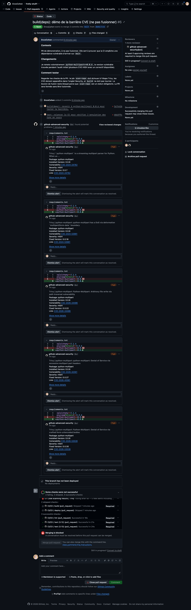
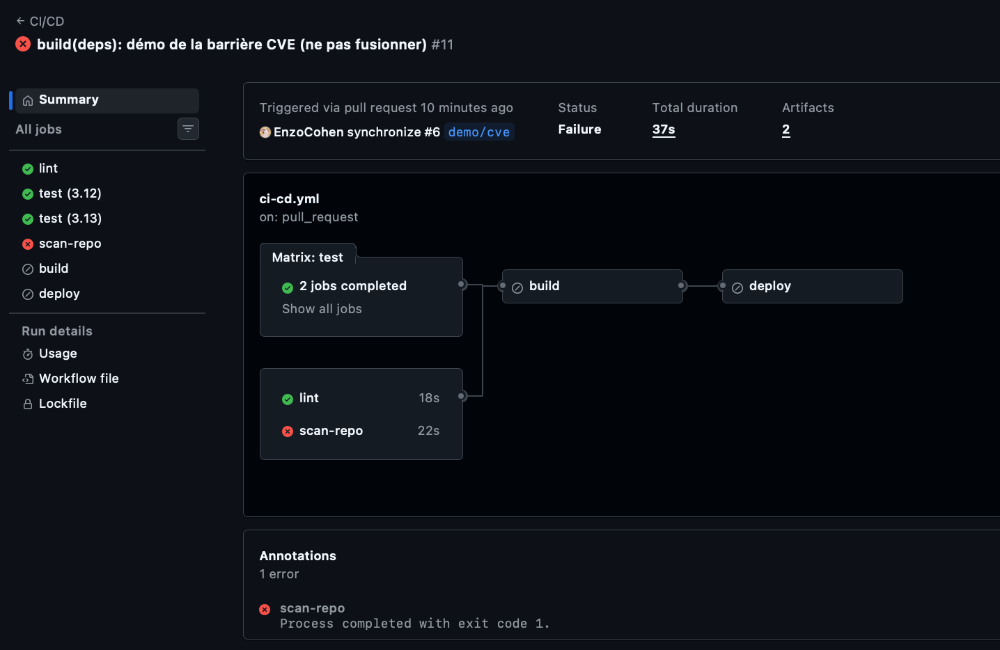

Trivy remonte 5 failles HIGH sur `python-multipart` (CVE-2024-24762, CVE-2024-53981, CVE-2026-24486, CVE-2026-42561 et CVE-2026-53539), visibles dans l'onglet Security ([lien](https://github.com/EnzoCohen/fretly-etu01/security/code-scanning?query=is%3Aopen+pr%3A6), réservé aux collaborateurs du dépôt).

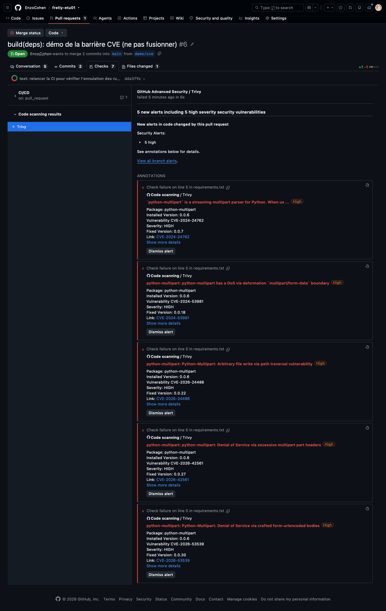
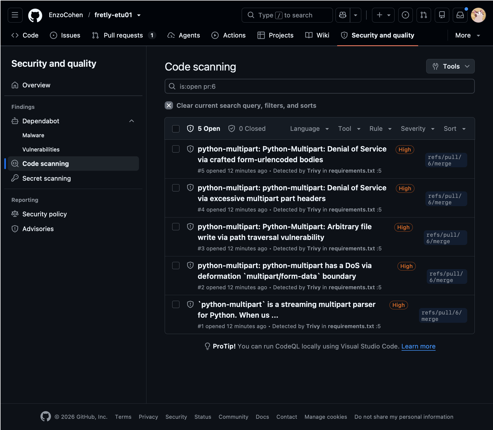

Sur cette même PR, j'ai poussé un deuxième commit pendant que le premier run tournait, et le premier [a bien été annulé](https://github.com/EnzoCohen/fretly-etu01/actions/runs/40673880431).

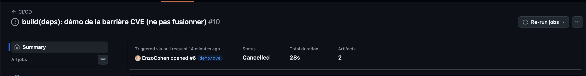

## Captures

Le run vert avec déploiement est dans la partie « Pipeline CI/CD », la protection de `main` dans « Stratégie de branches » et la PR `demo/cve` juste au-dessus.

Le paquet sur ghcr.io au moment de la capture, avec `latest` et `sha-fc35fb9` sur la même image (chaque nouveau push sur `main` publie un nouveau tag `sha-…` et déplace `latest`) :

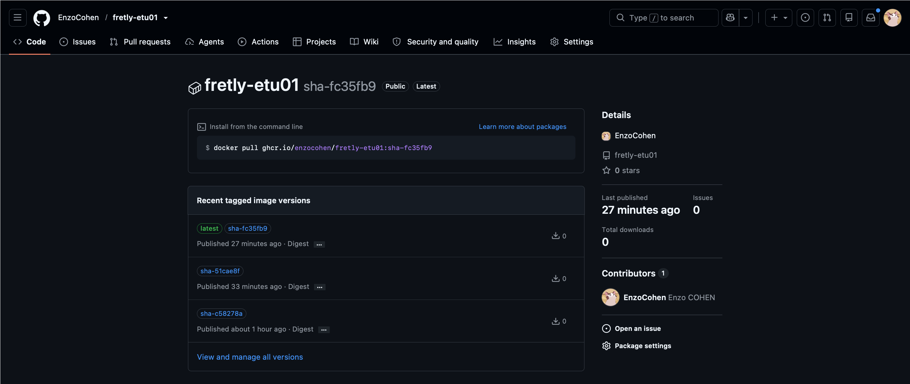

L'API servie sur l'EC2 à l'adresse http://51.44.164.69:8001/docs :

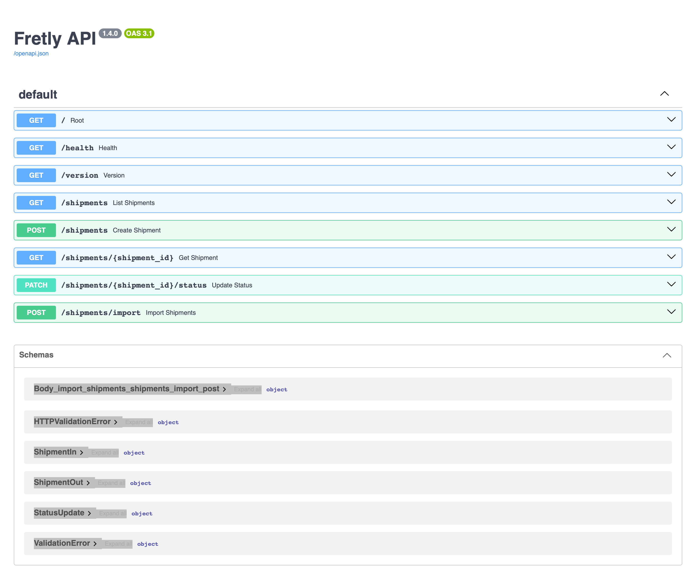

Et http://51.44.164.69:8001/version, qui renvoie le commit de `main` déployé :

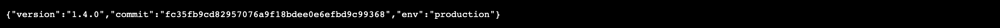

## Limites et améliorations

L'image n'est pas signée. Avec cosign, on pourrait la signer dans le job `build` et vérifier la signature sur le serveur avant de la lancer.

Le déploiement utilise une clé SSH stockée dans GitHub, valable sans limite de temps. Avec OIDC, GitHub Actions obtiendrait des identifiants AWS temporaires et pourrait déployer via SSM, sans clé SSH ni port 22 ouvert.

Tout part directement en production. Il faudrait un environnement de recette déployé d'abord, avec une validation manuelle avant la prod. On pourrait y lancer un scan DAST (OWASP ZAP), puisqu'aujourd'hui on analyse le code et l'image mais jamais l'API qui tourne.

Un scan Trivy planifié chaque semaine sur l'image en production permettrait de suivre les failles sans correctif et celles publiées après le déploiement.

Enfin, l'API est en HTTP, donc la clé d'API passe en clair sur le réseau. Il manque aussi des migrations de base et une sauvegarde du volume PostgreSQL.
